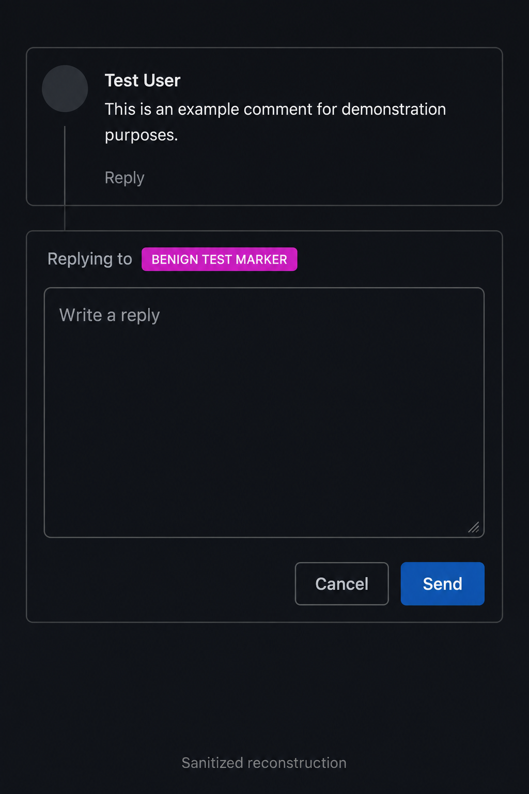
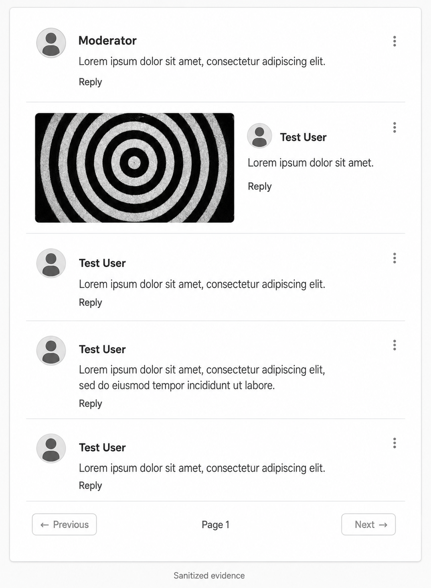

# Stored XSS in profile metadata (authorized assessment)

> **Type:** Authorized security finding<br>
> **Status:** Confirmed; published as an anonymized case study<br>
> **Classification:** CWE-79

← [Back to findings index](../README.md)

> An anonymized case study covering two responsibly disclosed Stored XSS findings discovered during an authorized assessment of a Firebase-based web application.

## Responsible disclosure notice

This assessment was performed with explicit authorization. The target, owner, users, domain, source repository, infrastructure identifiers, and reusable payloads have intentionally been withheld. Testing used disposable accounts and non-destructive markers and stopped after the agreed impact was demonstrated.

The images in this repository are **sanitized reconstructions** based on private evidence. They preserve the security-relevant behavior while removing the target's visual identity, content, users, dates, and technical identifiers. They are not presented as untouched forensic screenshots.

## Resumo em português

Durante uma avaliação autorizada, identifiquei duas formas de Stored XSS causadas pelo tratamento inseguro de metadados editáveis do perfil do usuário.

O primeiro caminho envolvia o `displayName`: uma visualização tratava o valor como texto, mas o fluxo de respostas o reutilizava em um contexto HTML inseguro. O segundo envolvia o `photoURL`, que era interpolado diretamente no HTML durante a renderização de comentários.

Os dois caminhos foram validados usando contas descartáveis e marcadores visuais benignos. Nenhuma credencial foi coletada, nenhuma ação destrutiva foi executada e nenhuma conta de terceiro foi utilizada como alvo. O proprietário foi informado privadamente e autorizou a publicação desta versão anônima.

Também foi revisada a resistência do fluxo de autenticação a tentativas repetidas. Esse item permanece separado dos findings confirmados até que quantidade de tentativas, duração, respostas do provedor e eventual throttling estejam completamente documentados.

## Executive summary

During an authorized security review of a Firebase-based publishing application, I identified two stored client-side injection paths involving editable user profile metadata.

The first path involved `displayName`. One view handled the value as text, while the reply flow reused the stored value in an unsafe HTML context. The second path involved `photoURL`, which was directly interpolated into HTML when comments were rendered.

Both paths were validated using disposable accounts and harmless visual markers. No credentials were collected, no destructive actions were performed, and no third-party account was targeted. The owner was privately notified and authorized this anonymized publication.

## Findings overview

| ID | Finding | Classification | Status |
|---|---|---|---|
| F-01 | Stored XSS through `displayName` in the reply flow | CWE-79 | Confirmed with a benign marker |
| F-02 | Stored XSS through `photoURL` in comment rendering | CWE-79 | Confirmed with a benign marker |
| O-01 | Resistance to repeated authentication attempts | CWE-307 candidate | Requires complete rate-limit evidence |
| O-02 | Current user can update their own `displayName` and `photoURL` through the Firebase API | Expected Firebase behavior | Enabling condition, not a standalone vulnerability |

Severity is context-dependent. In particular, it depends on whether the affected component is rendered by another user, whether JavaScript execution is possible in that context, and the privileges available to the viewing session. No claim of administrator, account, or server takeover is made in this report.

## Scope and methodology

- Testing was explicitly authorized by the application owner.
- Only accounts controlled by the tester were used.
- Profile metadata, comment rendering, reply rendering, and relevant authorization boundaries were reviewed.
- The source-to-sink path was traced from editable identity metadata to browser HTML-parsing operations.
- Proofs of concept used visible, non-destructive markers.
- Testing stopped after controlled DOM modification was established.
- Findings were privately disclosed with remediation guidance.

## F-01 — Stored XSS through `displayName` in the reply flow

### Description

An authenticated user could edit their own `displayName`, which was then stored or propagated as profile metadata. The ordinary comment view encoded the name safely, but the reply component later consumed the same value through an HTML-parsing path.

This created an inconsistent trust boundary: the value appeared harmless in one component but became executable markup when the reply interface rendered it.

```text
User-controlled displayName
        ↓
Identity profile / application data
        ↓
Safely displayed by one renderer
        ↓
Reused in an unsafe HTML context by the reply renderer
        ↓
Stored client-side injection
```

### Sanitized evidence



*Figure 1 — Sanitized reconstruction showing a benign stored marker being interpreted by the reply component. The image contains no target identifiers or reusable payload.*

### Impact

The confirmed result was persistent, attacker-controlled DOM modification in the reply flow. Depending on the victim context and browser policy, Stored XSS can enable misleading in-origin interfaces or actions performed with the privileges of the viewing application session.

The proof of concept did not collect credentials, extract session material, or perform privileged actions.

## F-02 — Stored XSS through `photoURL` in comment rendering

### Description

The application treated the profile photo field as a trusted image URL. The user-controlled value was later copied into comment data and interpolated into an HTML string. Because it reached an HTML-parsing sink without context-aware validation or encoding, the value could alter the generated markup.

```text
User-controlled photoURL
        ↓
Firebase Authentication profile
        ↓
Value copied into stored comment data
        ↓
Comment renderer builds an HTML string
        ↓
Browser parses attacker-controlled markup
```

### Sanitized evidence



*Figure 2 — Sanitized reconstruction showing a profile-photo value producing an unexpectedly large stored element inside a comment. The original artwork, users, content, dates, and target styling were removed.*

### Simplified vulnerable pattern

The following generic pseudocode illustrates the relevant class of sink and is not copied from the target:

```js
const avatarUrl = user.photoURL;

commentsContainer.insertAdjacentHTML(
  "beforeend",
  ``
);
```

Authentication establishes which user supplied the value; it does not make that value safe for an HTML context.

## O-01 — Authentication rate-limit assessment

The application's interface did not display a progressive delay, challenge, or temporary lock during the initial controlled test window. This observation is not presented as a confirmed brute-force vulnerability because Firebase Authentication has provider-side quotas and abuse protections that may activate separately from the application interface.

A conclusive retest should record:

- authentication method and endpoint class;
- attempt count and duration;
- whether attempts target one disposable account or several;
- HTTP status and Firebase error codes;
- whether `too-many-requests` or `TOO_MANY_ATTEMPTS_TRY_LATER` eventually appears;
- source-address and account-level behavior;
- the predefined stop condition used to prevent denial of service.

## O-02 — Editing the current user's profile through the API

Firebase intentionally permits an authenticated user to update their own `displayName` and `photoURL` using `updateProfile`. Calling the documented API directly instead of using a visible interface button is not an authorization bypass.

This behavior matters as an enabling condition for F-01 and F-02 because the application assumed the editable values were trusted. It would become a separate authorization finding only if an ordinary user could modify another account, a protected role, or data the security model promises is immutable.

## Root cause

The root cause was unsafe output handling at the application layer:

- user-controlled identity metadata was treated as presentation-safe data;
- strings were interpolated into HTML instead of assigned through safe DOM APIs;
- output handling was inconsistent between ordinary comments and replies;
- the image-specific field lacked strict URL parsing and validation;
- the application relied on authentication as though it were input sanitization.

Firebase's documentation explicitly warns that `displayName` and `photoURL` are not filtered to prevent XSS-type attacks. The application consuming those values must render them safely.

## Remediation

### Construct DOM nodes without parsing untrusted HTML

```js
const FALLBACK_AVATAR = "/assets/default-avatar.png";

function safeHttpsUrl(value) {
  try {
    const parsed = new URL(value);
    return parsed.protocol === "https:" ? parsed.href : FALLBACK_AVATAR;
  } catch {
    return FALLBACK_AVATAR;
  }
}

const avatar = document.createElement("img");
avatar.className = "avatar";
avatar.alt = "";
avatar.src = safeHttpsUrl(user.photoURL);

const name = document.createElement("span");
name.textContent = user.displayName || "User";

commentsContainer.append(avatar, name);
```

### Defense in depth

1. Use `textContent` for names, comments, labels, and other plain text.
2. Assign URLs through DOM properties only after parsing and validating them.
3. Restrict avatar URLs to `https:` and, where practical, expected image hosts.
4. Remove untrusted data from `innerHTML`, `outerHTML`, and `insertAdjacentHTML` flows.
5. If rich HTML is a product requirement, use a maintained allowlist-based sanitizer.
6. Clean or invalidate unsafe values already stored in profile and comment records.
7. Deploy a restrictive response-header Content Security Policy as defense in depth.
8. Add regression tests for quotes, angle brackets, encoded characters, malformed URLs, and oversized values.
9. Apply multi-factor authentication and additional monitoring to privileged accounts.

## Retest checklist

- [ ] A profile name containing HTML delimiters renders only as text.
- [ ] The reply component handles the name identically to the ordinary comment view.
- [ ] An invalid or non-HTTPS avatar value falls back to a default image.
- [ ] Stored legacy values cannot create elements or attributes.
- [ ] Comments, replies, reports, search results, and moderator views use safe rendering rules.
- [ ] The issue remains blocked after reload and in a separate test account.
- [ ] Authentication throttling is measured using an agreed bounded test plan.
- [ ] The fix is independently retested before the assessment is marked closed.

## Lessons learned

- Authenticated data is still untrusted input.
- Secure database rules do not compensate for unsafe browser rendering.
- Output encoding is context-specific and must be consistent across every component.
- Documented platform behavior can become dangerous when an application crosses a trust boundary incorrectly.
- A minimal proof of concept can establish impact without credential theft or destructive testing.
- Precise reporting is as important as exploitation: demonstrated impact must remain separate from hypothetical escalation.

## Skills demonstrated

- authorized web application security testing;
- client-side source-to-sink and DOM analysis;
- Firebase Authentication and Firestore trust-boundary review;
- Stored XSS validation using non-destructive proofs of concept;
- impact scoping and responsible disclosure;
- remediation design and regression-test planning;
- technical reporting for both engineering and non-technical audiences.

## References

- [Firebase — Manage users and profile-field XSS warning](https://firebase.google.com/docs/auth/web/manage-users)
- [Firebase Authentication limits](https://firebase.google.com/docs/auth/limits)
- [Firebase Auth REST API and excessive-attempt errors](https://firebase.google.com/docs/reference/rest/auth)
- [MDN — `insertAdjacentHTML()` security considerations](https://developer.mozilla.org/en-US/docs/Web/API/Element/insertAdjacentHTML)
- [MITRE CWE-79](https://cwe.mitre.org/data/definitions/79.html)
- [MITRE CWE-307](https://cwe.mitre.org/data/definitions/307.html)
